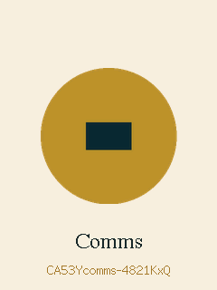
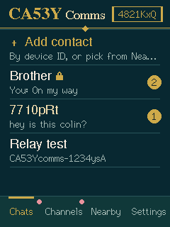
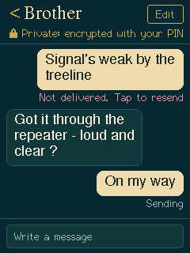
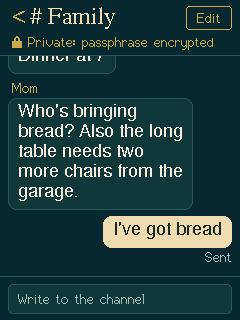

# CA53Y Comms Display

Off-grid text messaging for the **2.8" ESP32-32E touch display** (240x320, resistive touch). Message other
CA53Y devices over ESP-NOW with no internet, router, phone or Bluetooth. Every device also repeats what it
hears, so messages hop across devices to reach people out of direct range.

<p>




</p>

## What it does

- **Direct messages** to contacts, open or encrypted with a PIN you both set (AES-128-GCM).
  Delivery receipts, automatic retries, and tap-to-resend.
- **Channels** for group chat. *Public* is open to everyone; add a passphrase to make a private, encrypted one.
- **Mesh repeating** of every CA53Y message it hears, up to 8 hops. Repeaters can't read encrypted messages.
- **Nearby** list of devices in direct range with signal strength. Tap one to add it.
- Works alongside the other CA53Y Comms devices (dev-module messengers and relay boards).
- Unread badges, message pop-ups, a chime on the speaker port, RGB LED status, screen sleep.

## Which board you have

The board is sold as "2.8inch ESP32-32E Display" / "ESP32-32E 240x320 Resistance Touch" (LCDwiki
E32R28T). It comes in two versions that look identical:

| Version   | Screen chip | Firmware file |
|-----------|-------------|---------------|
| E32R28T   | ILI9341     | `CA53Y_Comms_Display_ILI9341.bin` (most boards; try this first) |
| E32R28T-1 | ST7789      | `CA53Y_Comms_Display_ST7789.bin` |

Flashed the wrong one? The screen stays blank or the colors look like a photo negative. Flash the other.

## Standard or Long Range

Every build comes in two networks:

| Network        | `LONG_RANGE` | Radio                                                                 |
|----------------|--------------|-----------------------------------------------------------------------|
| **Standard**   | `0`          | Normal ESP-NOW                                                        |
| **Long Range** | `1`          | Espressif's Long Range (LR) mode at 250 kbps. Each hop reaches farther |

**Standard and Long Range devices can't hear each other.** Use the same setting as the messengers and relays
in your group ([CA53Y Comms](https://github.com/colinjcasey/CA53Y-Comms) has both). Settings > About shows
which network a display is on, and the serial monitor prints it at boot. Long Range installs from the web
flasher keep your name, contacts and channels unless you tick Erase.

## Flash it

### Easiest: from the browser

Open the project's web flasher (GitHub Pages, see below) in **Chrome or Edge** on a computer, plug the
board in with a USB-C *data* cable, and click the button for your version.

### Arduino IDE

1. **Boards Manager:** install **esp32 by Espressif Systems**, version **3.x** (built and tested on 3.3.12).
2. **Library Manager:** install **LovyanGFX** (tested on 1.2.33).
3. Open `CA53Y_Comms_Display/CA53Y_Comms_Display.ino`. Keep the folder name the same as the `.ino`.
4. If you have the 2025 board, set `#define CA53Y_PANEL 1` in `config.h`.
5. Tools > Board: **ESP32 Dev Module**. Partition scheme: **Default 4MB with spiffs** (the default).
6. Upload. If it won't connect, hold **BOOT**, tap **RESET**, release **BOOT**, and try again.

### arduino-cli

```sh
arduino-cli core install esp32:esp32@3.3.12
arduino-cli lib install "LovyanGFX@1.2.33"
arduino-cli compile -b esp32:esp32:esp32 CA53Y_Comms_Display \
  --build-property "compiler.cpp.extra_flags=-DCA53Y_PANEL=0 -DLONG_RANGE=0"   # PANEL 1 = ST7789 board, LONG_RANGE 1 = Long Range
arduino-cli upload -b esp32:esp32:esp32 -p /dev/ttyUSB0 CA53Y_Comms_Display
```

### esptool (prebuilt file)

```sh
esptool.py --chip esp32 --port /dev/ttyUSB0 write_flash 0x0 docs/firmware/CA53Y_Comms_Display_ILI9341.bin
```

Long Range (keeps saved settings; use the `ST7789_LR` files for the 2025 board):

```sh
cd docs/firmware/lr
esptool.py --chip esp32 --port /dev/ttyUSB0 write_flash 0x1000 CA53Y_Comms_Display_ILI9341_LR.bootloader.bin \
  0x8000 CA53Y_Comms_Display_ILI9341_LR.partitions.bin 0xe000 boot_app0.bin 0x10000 CA53Y_Comms_Display_ILI9341_LR.bin
```

## First boot

1. **Touch setup:** tap each arrow tip with the stylus. Redo it any time in Settings > Calibrate touch.
2. **Your name:** shown to people you message.
3. You land on **Chats**. Your device ID is in the plate at the top right (the full ID is under Settings > About).

## Using it

- **Add a contact:** open **Nearby** and tap a device, or tap **Add contact** and type the 7 characters after
  `CA53Ycomms-`. Someone who messages you first is added automatically.
- **Encrypt a conversation:** in the contact's screen, set a **Shared PIN**. They must set the *same* PIN for
  you. If the PINs don't match, messages still arrive but show as locked, and you'll see
  "Delivered, but their PIN doesn't match". A few words make a far stronger PIN than 4 digits.
- **Channels:** tap **Join a channel**, type a name, and optionally a passphrase. Everyone who joins the same
  name and passphrase is in the same group. Leave the passphrase empty for an open channel.
- **Repeating** is on by default (Settings > Repeat messages). Leave it on; it's how the mesh reaches far.
  A spare board powered from a USB charger makes a good fixed repeater.
- **Erase everything:** Settings > Erase everything, or hold **BOOT** for 5 seconds. The device ID is kept.

Messages are kept in memory and clear on restart. Contacts, PINs, channels and settings are saved.

LED: **blue** blink while you have unread messages, **green** flash each time the device repeats a message,
**red** while BOOT is held.

## Works with

All CA53Y Comms devices use protocol v2 on Wi-Fi channel 1, on the same network (Standard or Long Range):

- **CA53Y Comms dev-module messengers** (phone portal at 192.168.4.1): direct messages work both ways,
  including PIN encryption. They don't have channels, but they repeat channel messages.
- **CA53Y relay boards** (S3 antenna relay, T-Dongle relay): repeat everything this device sends.

The full packet format is in [PROTOCOL.md](PROTOCOL.md) if you want to build your own.

## Customize

- **Your own boot logo:** `pip install pillow`, then `python tools/make_logo.py my_logo.png`. This writes
  `CA53Y_Comms_Display/logo.h`, which the next build picks up. Delete the file to go back to the sunburst.
- **Screen upside down:** `DISPLAY_ROTATION 2` in `config.h`.
- **Colors inverted:** flip `PANEL_INVERT` in `config.h`.
- **Radio channel / hop limit:** `ESPNOW_CHANNEL` and `MAX_HOPS` in `config.h`. These must match on every
  device, so leave them alone unless you're changing all of them.

## Troubleshooting

| Problem | Fix |
|---|---|
| Blank or white screen, backlight on | Wrong screen version: flash the other file / change `CA53Y_PANEL` |
| Colors look negative | Flip `PANEL_INVERT` |
| Taps land in the wrong place | Settings > Calibrate touch |
| No serial port appears | Use a data cable; install the CH340 driver |
| Nearby is empty | The other device must be on, set up, and have "Visible to others" on. Messages can still reach it by ID through repeaters |
| "Not delivered" | Out of range with no repeater in between; add one, or move closer |
| Dev-module board can't hear it | Make sure that board runs the protocol v2 (mesh) firmware |

## Board pins

| Part | Pins |
|---|---|
| LCD (SPI2) | SCK 14, MOSI 13, MISO 12, CS 15, DC 2, reset = EN, backlight 21 |
| Touch XPT2046 (SPI3) | SCK 25, MOSI 32, MISO 39, CS 33, IRQ 36 |
| RGB LED (low = on) | R 22, G 16, B 17 |
| Speaker | DAC 26, amp enable 4 (low = on) |
| BOOT button | 0 |

## License

MIT. See [LICENSE](LICENSE). The CA53Y name and logo belong to CA53Y IND.
